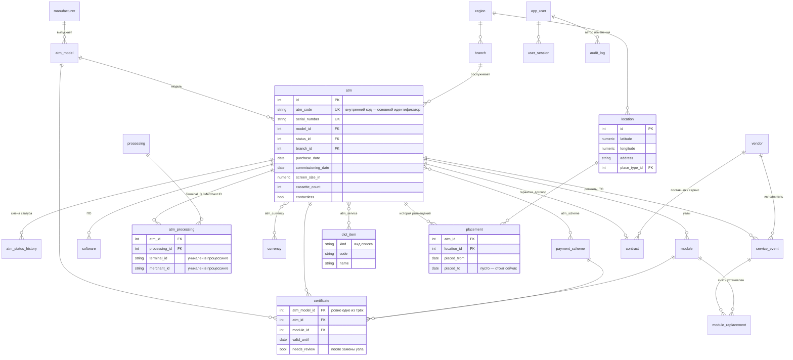

# ER-диаграмма

Схема БД справочника банкоматов. Источник истины — модели в [backend/app/models](../backend/app/models) и миграции Alembic.

## Ограничения, которые держит сама БД

| Правило | Как реализовано |
|---|---|
| Периоды размещения одного банкомата не пересекаются | exclusion constraint `ex_placement_no_overlap` (btree_gist, `daterange`) |
| У банкомата не больше одного текущего размещения | частичный unique-индекс `placed_to is null` |
| Terminal ID и Merchant ID уникальны внутри процессинга | `unique(processing_id, terminal_id)`, `unique(processing_id, merchant_id)` |
| Сертификат привязан ровно к одному объекту | `check num_nonnulls(atm_model_id, atm_id, module_id) = 1` |
| Координаты в пределах Узбекистана | `check latitude between 37 and 46 and longitude between 55 and 74` |
| Логин уникален без учёта регистра | unique-индекс по `lower(login)` |
| У ремонта есть исполнитель | `check vendor_id is not null or by_bank_engineer` |
